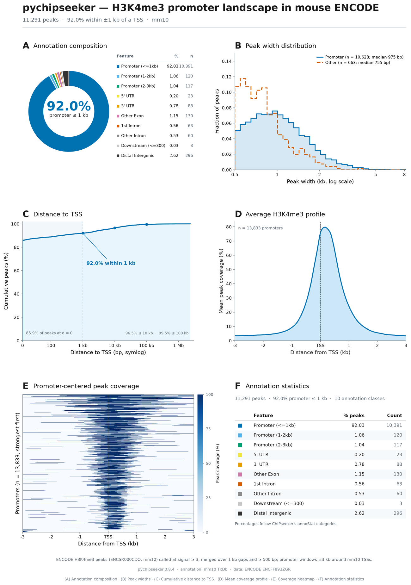
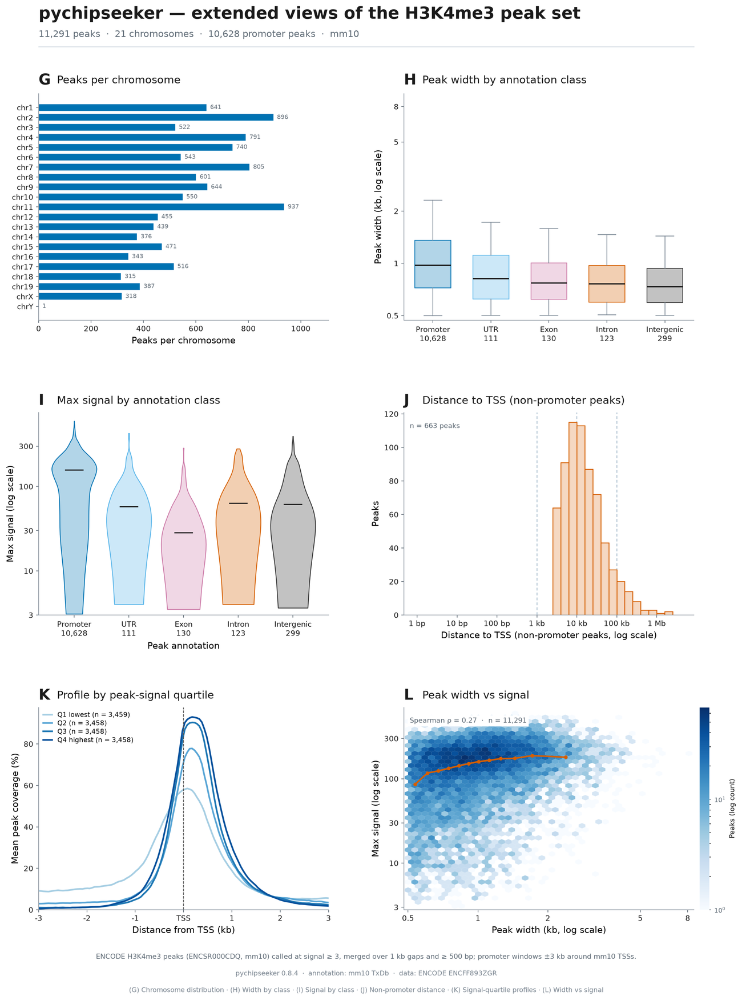
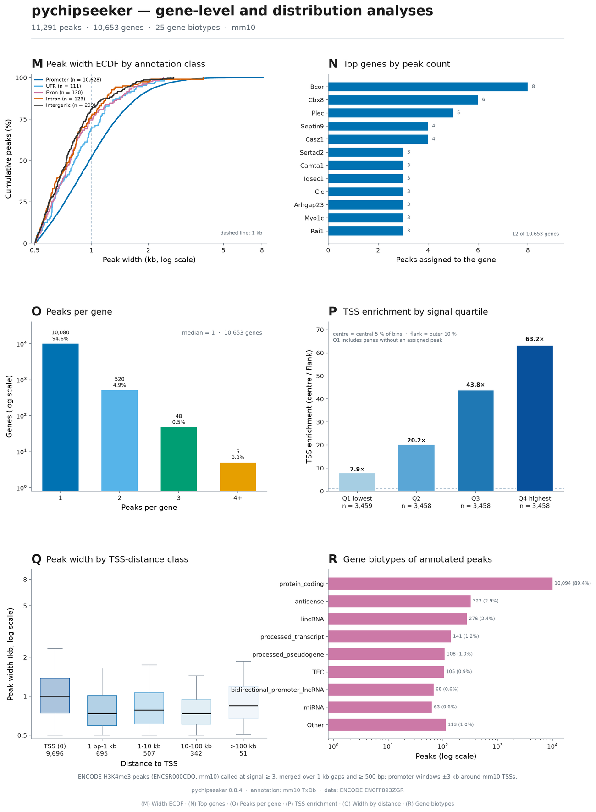
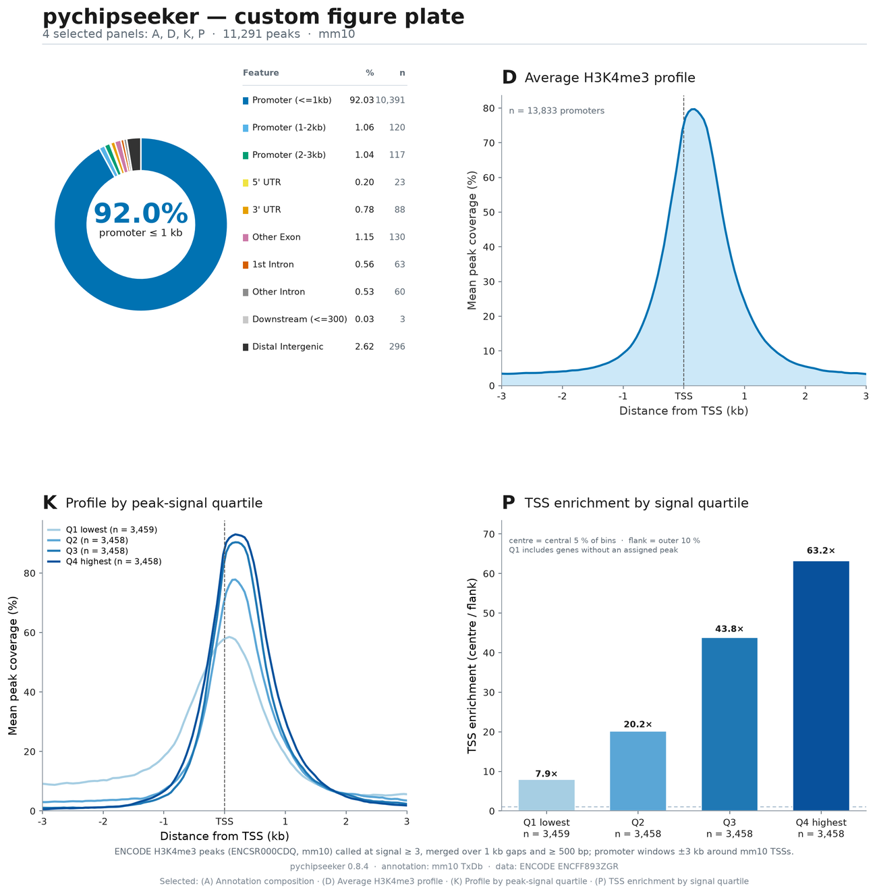

# Figure gallery

The repository includes a complete, reproducible example built from real
ENCODE H3K4me3 peaks in mouse (mm10, ENCSR000CDQ). It produces **three A3
plates**, **18 standalone panels** and an interactive HTML gallery.

Generate everything from the committed peak file:

```bash
python examples/make_encode_plate.py
```

Outputs land in `examples/output/encode/`:

| File | What it is |
|---|---|
| `encode_figure_plate.*` | Main plate A–F |
| `encode_supplementary_plate.*` | Extended plate G–L |
| `encode_analysis_plate.*` | Analysis plate M–R |
| `figures/<letter>_<name>.*` | 18 individual panels, five formats each |
| `encode_figures.pdf` | All 18 panels in one PDF |
| `encode_custom_plate.*` | Only when you pass `--panels` |
| `gallery.html` | Interactive index with filters and a command builder |

Every plate and panel is written as **PNG, PDF, SVG, EPS and TIFF**, plus a
600 dpi PNG of each plate. PDF files use Type 42 fonts and are safe for journal
submission; SVG text stays editable.

## Main plate — annotation story (A–F)

<figure class="shot" markdown>

<figcaption>
Composition, peak widths, cumulative TSS distance, mean profile, coverage
heatmap and the annotation statistics table.
</figcaption>
</figure>

## Extended plate — peak-set views (G–L)

<figure class="shot" markdown>

<figcaption>
Chromosome distribution, width and signal by class, non-promoter distances,
signal-quartile profiles and a width-vs-signal hexbin.
</figcaption>
</figure>

## Analysis plate — gene-level summaries (M–R)

<figure class="shot" markdown>

<figcaption>
Width ECDF, top genes, peaks per gene, TSS enrichment by signal quartile,
width by TSS-distance class and gene biotypes.
</figcaption>
</figure>

## Panel catalogue

| | Panel | Question it answers |
|---|---|---|
| A | Annotation composition | What fraction of peaks is promoter, UTR, exon, intron or intergenic? |
| B | Peak width distribution | How wide are promoter and non-promoter peaks? |
| C | Distance to TSS | What share of peaks lies within 1 kb, 10 kb or 100 kb of a TSS? |
| D | Average H3K4me3 profile | What does the mean coverage profile look like around the TSS? |
| E | Promoter-centred coverage | Which promoters are strongest, and how sharp is each peak? |
| F | Annotation statistics | What are the exact ChIPseeker-style counts and percentages? |
| G | Peaks per chromosome | How are peaks distributed across the genome? |
| H | Width by annotation class | Do promoters differ in width from UTRs, exons, introns and intergenic peaks? |
| I | Max signal by annotation class | Which classes carry the strongest signal? |
| J | Distance to TSS (non-promoter) | Where do the distal peaks sit? |
| K | Profile by signal quartile | Do stronger peaks produce sharper TSS profiles? |
| L | Width vs signal | Is wider also stronger? (hexbin + median trend) |
| M | Width ECDF by class | What fraction of each class is below 1 kb? |
| N | Top genes by peak count | Which genes carry the most peaks? |
| O | Peaks per gene | How many genes have one, two, three or more peaks? |
| P | TSS enrichment by signal quartile | Centre-to-flank enrichment for Q1–Q4. |
| Q | Width by TSS-distance class | How does width change from TSS to >100 kb? |
| R | Gene biotypes | Which biotypes do annotated peaks belong to? |

## Download a sample PDF plate

Two ready-made PDFs are included with the documentation:

- [Custom plate with A, D, K and P](assets/pdf/custom-plate.pdf) — shows how a
  selection looks on one page.
- [Analysis plate M–R](assets/pdf/analysis-plate.pdf) — the full gene-level
  summary page.

<figure class="shot" markdown>

<figcaption>
A custom A3-style plate built from panels A, D, K and P. The same command can
select any subset of the 18 panels.
</figcaption>
</figure>

## Run one panel on your own peaks

You do not have to generate the whole gallery. `examples/plot_one_panel.py`
takes any peak file and renders exactly one panel as PDF:

```bash
python examples/plot_one_panel.py --list
python examples/plot_one_panel.py \
    --panel K --peaks my_peaks.bed --txdb mm10 \
    --outdir figures --formats pdf
```

The output is `figures/K_K_profile_quartiles.pdf`. Add `png,svg,eps,tif` to
`--formats` if you need more than vector PDF.

Every panel design is ordinary matplotlib code in
`examples/make_encode_plate.py`. Copy the `_figure_*` function you need, or use
the public helpers directly:

```python
import matplotlib.pyplot as plt
import pychipseeker as pcs

ann = pcs.annotate_peak("my_peaks.bed", TxDb="mm10")

fig, ax = ann.plot_anno_pie()
fig.savefig("my-annotation.pdf", bbox_inches="tight")
plt.close(fig)
```

This keeps the choice with the author: use the full curated plate, a custom
subset, a single gallery panel, or your own matplotlib layout.

## Choose only the panels you need

List the catalogue:

```bash
python examples/make_encode_plate.py --list-panels
```

Compose a custom plate from letters or stems:

```bash
python examples/make_encode_plate.py --panels A,C,K,P
python examples/make_encode_plate.py --panels width_ecdf,gene_biotypes
python examples/make_encode_plate.py --panels all
```

The selection is written to `encode_custom_plate.*` in every requested format,
including PDF. The three curated plates are still refreshed, so you never lose
the full set.

Limit the export formats when you only need vector output:

```bash
python examples/make_encode_plate.py --formats pdf,svg
```

## Interactive gallery

`examples/output/encode/gallery.html` is a self-contained index of the run:

- grouped sections for main, extended and analysis views;
- filter buttons for each group;
- a checkbox on every panel;
- an auto-updating `--panels` command with a copy button;
- PDF-first download links, plus PNG, SVG, EPS and TIFF.

Open it directly in a browser after running the script. The HTML references
files under `figures/`, so keep the folder next to it.

## Reproducibility notes

The committed `examples/encode_peaks.bed` contains 11,291 peaks called from the
ENCODE signal track (`ENCFF893ZGR`) at signal ≥ 3, merged over 1 kb gaps and
filtered to ≥ 500 bp. These are **threshold-called from the signal**, not
ENCODE's own narrowPeak calls.

The example needs only the core install and the cached mm10 genome bundle. It
does not need a bigWig at run time; peak-coverage matrices drive the profiles.

!!! note "Signal quartiles"

    `signal_groups` ranks promoters by the strongest peak score assigned to
    each gene. Genes without an assigned peak get a score of zero, so they stay
    in Q1 instead of being dropped. This is why panel P is monotonic and why Q1
    still contains promoters with a visible, broader shoulder.

## Use the helpers in your own project

The panels are ordinary matplotlib code. The analysis helpers behind them are
public API:

```python
import pychipseeker as pcs

pcs.top_genes(df, n=12)
pcs.peaks_per_gene(df)
pcs.gene_type_summary(df, top=8)
pcs.signal_groups(tag, peaks, n_groups=4)
pcs.tss_enrichment_by_quartile(tag, peaks, n_groups=4)
```

See [Analysis recipes](analysis.md) for inputs, outputs and plotting examples.
