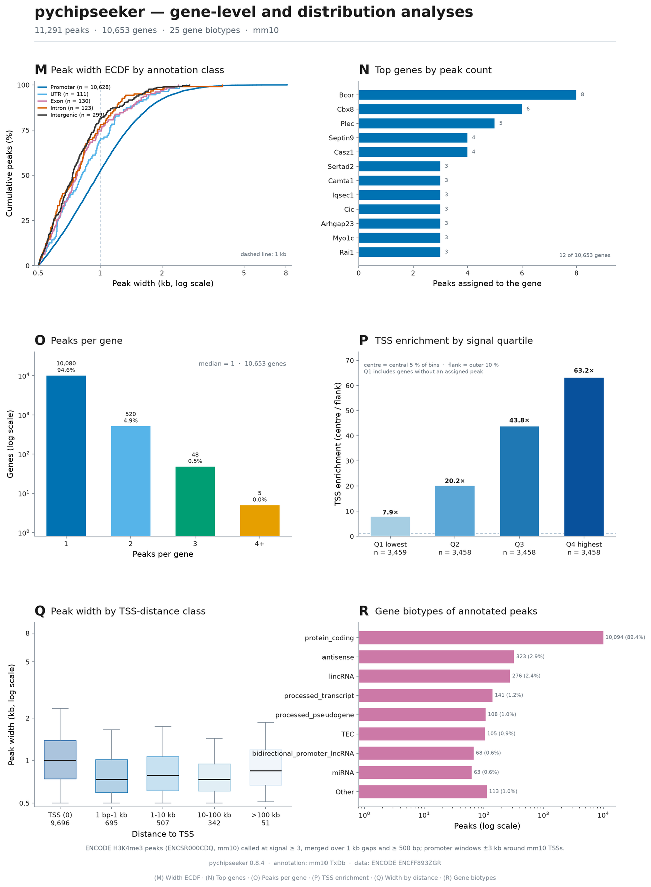

---
hide:
  - navigation
  - toc
---

<div class="hero" markdown>

# Peak annotation and figures, without leaving Python

<p class="lead">
pychipseeker brings ChIPseeker-compatible peak annotation, tag matrices,
quality control and publication-ready figures to a small NumPy / pandas /
matplotlib stack. Annotate a peak file, inspect the result, and export a
journal-ready PDF in the same script.
</p>

<div class="badges" markdown>
[](https://pypi.org/project/pychipseeker/)
[](https://pypi.org/project/pychipseeker/)
[](https://github.com/summus-kong/pychipseeker/actions/workflows/ci.yml)
[](https://github.com/summus-kong/pychipseeker/blob/main/LICENSE)
</div>

<div class="actions" markdown>
[Quick start](quickstart.md){ .md-button .md-button--primary }
[Install](installation.md){ .md-button }
[Browse the figure gallery](gallery.md){ .md-button }
[Function reference](reference/functions.md){ .md-button }
</div>

</div>

## Install and annotate in under a minute

=== "Install"

    ```bash
    pip install pychipseeker
    ```

    The core needs only NumPy, pandas and matplotlib. Optional extras add
    bigWig, BAM, bigBed and enrichment support.

=== "Annotate"

    ```python
    import pychipseeker as pcs

    ann = pcs.annotate_peak("peaks.bed", TxDb="mm10")
    print(ann.annoStat)
    df = ann.to_dataframe()
    ```

=== "Plot"

    ```python
    fig, ax = ann.plot_anno_pie()
    fig.savefig("annotation.pdf", bbox_inches="tight")
    fig.savefig("annotation.svg", bbox_inches="tight")
    ```

The first `TxDb="mm10"` call downloads a compact genome bundle once and caches
it. Later runs load the cache in about two seconds. Local GTF/GFF files, DataFrames,
Ensembl/GENCODE specs and arbitrary URLs work too — see
[Genomes and TxDb](genomes.md).

## Why people use it

<div class="grid cards" markdown>

-   **ChIPseeker semantics, Python ergonomics**

    ---

    Promoter bins, annotation priority and signed TSS distances follow
    ChIPseeker's rules. The camelCase aliases (`annotatePeak`, `plotAnnoPie`,
    …) sit next to snake_case ones, so R habits still work.

-   **Small core, optional power**

    ---

    Annotation, summaries, tag matrices, overlap tests and reports run on
    NumPy, pandas and matplotlib alone. Install `[bigwig]`, `[bam]`,
    `[enrich]` only when you need them.

-   **Eighteen figure panels, all with PDF**

    ---

    Three curated A3 plates plus individual panels: composition, widths,
    TSS distance, profiles, heatmaps, chromosomes, gene burden, biotypes and
    signal-quartile enrichment. Pick the ones you want with one CLI flag.

-   **Plot-ready summaries**

    ---

    `annotation_summary`, `peaks_per_gene`, `top_genes`,
    `gene_type_summary`, `distance_summary`, `signal_groups` and
    `tss_enrichment_by_quartile` return plain DataFrames you can table or plot.

-   **Quality control and reports**

    ---

    Peak widths, blacklist and mitochondrial fractions, FRiP and TSS
    enrichment from bigWig or BAM, plus a multi-page PDF report from one
    command.

-   **Windows, Linux and macOS**

    ---

    Pure-Python wheel, no compiler required. Optional `pyBigWig` / `pysam`
    paths use conda-forge/bioconda when wheels are unavailable.

</div>

## What the figures look like

<figure class="shot" markdown>

<figcaption>
Analysis plate (M–R): width ECDF, top genes, peaks per gene, TSS enrichment by
signal quartile, width by TSS-distance class, and gene biotypes. Every plate and
panel is exported as PNG, PDF, SVG, EPS and TIFF.
</figcaption>
</figure>

The gallery is generated from the real ENCODE H3K4me3/mm10 example in the
repository — 11,291 peaks, 92.0 % within 1 kb of a TSS. See
[Figure gallery](gallery.md) for all three plates and the panel catalogue.

## Analysis helpers

```python
import pychipseeker as pcs

df = ann.to_dataframe()
peaks = df.merge(ann.peaks[["peak_id", "score"]], on="peak_id", how="left")

pcs.annotation_summary(df)            # counts and widths per class
pcs.top_genes(df, n=12)               # genes with the most peaks
pcs.gene_type_summary(df, top=8)      # biotypes, tail folded into Other
pcs.distance_summary(df)              # promoter fraction, distance quantiles
```

Recipes for every helper, including signal quartiles and TSS enrichment, are in
[Analysis recipes](analysis.md).

## Where to go next

<div class="grid cards" markdown>

-   [**Installation**](installation.md)

    Core install, optional extras, Windows notes and local docs preview.

-   [**Quick start**](quickstart.md)

    Annotate, inspect, plot, build tag matrices, run QC and write a report.

-   [**Figure gallery**](gallery.md)

    Browse the plates, choose panels with `--panels`, and export vector files.

-   [**API overview**](api.md)

    The main objects, functions and output columns at a glance.

-   [**Function reference**](reference/functions.md)

    All 94 public functions, every parameter, type, default and meaning.

-   [**Command line**](cli.md)

    `annotate`, `plot`, `enrich`, `callpeak`, `filter`, `qc`, `report`, `cache`.

-   [**FAQ**](faq.md)

    Genome downloads, Windows optional dependencies, PDF fonts and more.

</div>
